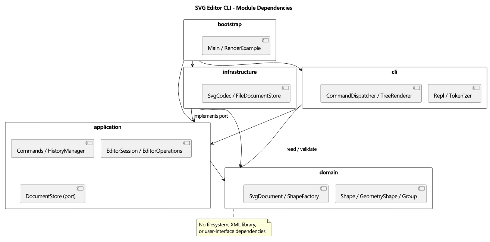

# Lab1 Phase 1 架构与过程记录

## 架构方案

### 模块划分

| 模块 | 职责 |
|---|---|
| domain | 封装图形、几何、树结构与唯一 id 不变量 |
| application | Command 执行、历史管理、文档会话、持久化接口 |
| infrastructure | XML 与本地文件适配 |
| cli | 命令行分词、命令分发、REPL、显示 |
| bootstrap | 依赖组装与启动 |

图的 [PlantUML 源码](architecture.puml) 与 [SVG 矢量图](architecture.svg) 一并提交，可独立修改和重新生成。依赖箭头表示“使用/实现该模块的类型”，并非运行时调用顺序。

实际工程还有 tests（验证）、examples（命令与图像样例）、doc（设计与过程）。这些不属于应用运行时模块。

### 设计模式

必须采用 Command：每种编辑一个命令类，通过统一历史管理器执行和撤销。采用 Composite：Group 和叶子同属 Shape，多态操作几何。采用集中式 ShapeFactory：所有类型名称到构造器的分派只在此处；命令名称到处理器的分派只在 CommandDispatcher。

| 模式/边界 | 对应代码及职责 |
|---|---|
| Command | application/Command.ts 定义 execute/undo/redo；十种编辑分别有命令类 |
| 快照备忘录 | SnapshotCommand 私有保存执行前后文档深克隆，失败回滚，undo/redo 恢复克隆；快照不暴露给 CLI |
| 历史管理 | HistoryManager 只在执行成功后修改栈；EditorSession 控制 IO 屏障和当前文件路径 |
| Composite | domain/Shape.ts 定义共同操作；GeometryShape 封装数值及几何规则；Group 递归委派 move/scale |
| 工厂 | ShapeFactory 同时服务 create 和 SVG 导入，避免解析层再建一份类型分派 |
| 端口适配 | DocumentStore 是应用层接口，FileDocumentStore/SvgCodec 隔离磁盘及 XML；Main 负责注入 |

持久化返回值和 Token 使用只读边界数据；领域模型本身的几何、样式、子列表和画布尺寸均封装在私有字段，通过行为修改。

两处名称分派均为后续待重构项：未来以插件注册机制替代内置清单。本阶段不实现 box 或完整插件系统。

### 依赖方向规则

Domain 不依赖其他层、Node IO 或 XML 库。Application 只依赖 Domain；持久化端口定义于 Application。Infrastructure 实现端口，可以依赖 Domain。CLI 依赖 Application，并允许只读访问 Domain 进行显示。Bootstrap 负责组装。测试可跨层验证。

### 变化点假设

1. 图形类型扩展：保留 Shape 多态和集中工厂；暂不实现动态插件加载。
2. 交互通道扩展：Command 和领域行为不依赖 REPL，可用于未来 GUI/agent。
3. 存储格式变化：通过 DocumentStore 端口隔离 XML 和磁盘。
4. 大文档历史性能：本阶段采用封装快照保证结构撤销可靠；规模扩大时替换为增量备忘录。

### 歧义决策

- 跨父节点 group：最低公共祖先作为新组父节点，原文档先序遍历决定成员顺序，最早被选中分支决定插入位置。
- 重复 id 拒绝导入；缺 id 先扫描显式 id，再分配不冲突编号。
- 文档命令成功后清空历史并设置屏障；失败不改变历史。canvas 查询不设置屏障。
- front 对应 SVG 后绘制（同级列表末尾），back 对应先绘制（开头）。
- 暂不支持复杂 SVG 元素或 transform；涉及渲染语义的未支持内容明确报错，避免静默损失。

## 过程记录

### 方案核验与工程建立

用户先要求方案，确认后指示开始实现。目标目录原为空，已初始化独立 Git 仓库。使用 AI 实现者和 AI 复核者两种视角；此处不将 AI 自查冒充人工校验，也不编造讨论。

环境检查发现 Node 与 pnpm 可用，npm 不在 PATH，使用随附 pnpm 管理本项目依赖，不修改全局环境。

### 复核 A：领域模型

六种类型共享 Shape/GeometryShape，几何和样式封装在私有字段。树查询采用遍历，避免同时维护父指针、id 缓存和子列表造成多份状态失配；本阶段小文档接受 O(n) 查询，唯一 id 在添加整棵子树前验证。相较方案中的 id 索引，这是主动简化，后续有性能依据再引入索引。

首次类型检查发现 TypeScript 7 不再隐式加载 Node 类型，已在 tsconfig 中显式声明 types: [node]。领域测试覆盖递归移动缩放、唯一 id、缺失容器、未知类型、非法尺寸、属性白名单和快照隔离。

### 基础编辑

EditorOperations 提供与 CLI 无关的编辑入口。验证了 in 指定父容器、缺省样式不写属性、浮点坐标、文本修改、删除子树，以及失败创建不会插入孤立节点。

### 复核 B：命令原子性与历史

复核发现：只在叶子层先验证不足以保证整组操作原子性。组内前面的图形缩放成功、后面的巨大坐标溢出时，会发生部分修改。SnapshotCommand 在修改前保留封装的深克隆，异常时恢复；HistoryManager 仅在 execute 成功后更新栈。用两个子图形（普通坐标与 1e308）的溢出回归测试确认整组回滚，且失败命令不占撤销单元。

另验证了失败编辑保留 redo，成功新编辑清空 redo，以及 IO 屏障必须等下一次成功编辑才解除。历史在本阶段使用全文档快照，时间和存储为 O(文档大小 × 历史长度)，是明确的规模取舍。

### 复核 C：层级及绘制顺序

group 先验证所有成员和祖孙冲突，再统一摘出。跨父节点测试故意以逆序参数输入，确认结果仍按原树顺序；撤销一次完整恢复原父节点和兄弟次序。ungroup 只允许非根级组，子节点替换原组槽位。front 放到 SVG 子列表末尾（后绘制），back 放到开头，避免把“最前”误解为数组开头。循环 addto、组与其后代同时选中均有失败回归测试。

### CLI 解析复核

Tokenizer 保留参数是否被双引号包裹的信息，避免将文字内容 "in" 误识别成父容器子句。注释仅在整行第一个非空白字符为 # 时生效，颜色 #4a90d9 不会被截断。Windows 路径中的普通反斜杠保持原样，仅引号内的双引号和反斜杠支持转义。help 可在尚未建文档时使用，其余依赖文档的命令拒绝执行。首轮 CLI 测试发现断言把属性分隔空格数量固定为一个，已改成验证语义允许连续空白。

### 复核 D：SVG 与文件边界

图形创建和 XML 还原共用 ShapeFactory，XML 适配器没有重复的 tag→类型分派。复核时补充空 text 的还原：应由工厂的类型描述决定是否接收内容，不能根据“是否存在文本节点”猜类型。XML 库负责实体转义，测试确认中文、&、尖括号和空文本可往返。

自动补 id 采用两遍扫描，验证缺 id 矩形出现在显式 rect1 之前的场景。解析错误、重复 id、未支持元素/属性均不替换旧文档。保存采用同目录随机临时文件加 rename；写失败时不清空历史，尽量清理临时文件。成功 read/save、init、canvas 修改才建立屏障。

本阶段支持六种类型及公共样式，允许省略 SVG 数值属性（按 0），支持 px 尺寸和与画布一致的 viewBox。transform、style、字体属性、path/use、不同坐标映射等未实现，明确拒绝。data-kind 在 g 上降级为普通组；没有实现 box 便利属性或复合图形保护。

### 完整会话与独立渲染

通过独立 CLI 子进程回放作业第 6 节会话，确认两条预期错误后程序继续工作，导入警告、保存文件、撤销后的文本和父级均正确。第 6.1 节版本 A 回放后导出 8 个元素，节点移动再撤销后 y 恢复为 100。

引入仅用于开发验证的 @resvg/resvg-js，独立于本编辑器的 XML 解析器渲染输出；验证 800×600 尺寸和两个矩形内部像素颜色。生成并目视检查 examples/flowchart.png，中文、连线及两个节点显示正常。当前浏览器控制因 URL 识别安全检查而中止，因此本轮未做浏览器界面预览；改用独立 SVG 渲染及图像目视检查，没有绕过浏览器安全限制。

用户明确确认使用 haoweiLiu9 后，验证本机现有 Git 凭据与该账户匹配，通过 GitHub API 创建私有 svg-editor-cli 仓库，并推送分步提交。未生成或保存新凭据。

## 一致性自查

### 模块划分

实际五个 src 子目录与方案一致，所有类与文件名一致。明确的修订为：将原计划 id 缓存改为遍历查询，减少冗余状态；增加 Numbers 和 GeometryShape 复用数值验证；增加只用于开发的 RenderExample 与 Windows 启动脚本。变更均已记入本文件。

### 依赖方向

通过 tests/architecture.test.ts 扫描所有源文件相对导入，并验证 Domain/Application 不导入 Node 或第三方包。当前无违反规则的依赖。抽样核对：

- application/SnapshotCommand → domain/SvgDocument，不触及 XML/磁盘。
- infrastructure/FileDocumentStore → application/DocumentStore，实现持久化端口。
- infrastructure/SvgCodec → domain/ShapeFactory，XML 类型分派没有复制到适配器。
- cli/CommandDispatcher → application 命令，领域几何由 Numbers 验证，不在 CLI 修改形状字段。
- bootstrap/Main → CLI、EditorSession、FileDocumentStore，负责依赖组装。

额外检查每个源文件至多一个导出的类、类名匹配文件名，且没有 switch 分派。两个集中名称注册表是架构方案中明确记录的后续待重构项。

## 质量保证手段

### 功能与验证对应

| 要求 | 实现入口 | 主要验证 |
|---|---|---|
| 六种图形、唯一 id、浮点几何、属性白名单 | ShapeFactory、Shape、GeometryShape、SvgDocument | domain.test、editing.test |
| create/delete/move/scale/set | 对应 Command 类、EditorOperations | editing.test、history.test、cli.test |
| group/ungroup/addto/front/back | SvgDocument 树操作及对应 Command | structure.test（跨父级、顺序、祖孙冲突、整组撤销） |
| undo/redo、失败原子性、IO 屏障 | SnapshotCommand、HistoryManager、EditorSession | history.test、persistence.test |
| init/read/save/canvas | EditorSession、FileDocumentStore | persistence.test、integration.test |
| # 注释、引号、in、错误格式 | Tokenizer、CommandDispatcher | cli.test、integration.test |
| tree/show/help | TreeRenderer、CommandDispatcher | cli.test、真实会话输出 |
| SVG 文本及样式往返、自动补 id | SvgCodec、ShapeFactory | persistence.test |
| 作业第 6 节及第 6.1 节案例 | examples/*.commands、Main/REPL | integration.test 的真实 CLI 子进程 |
| 可渲染图形 | 导出的 SVG、独立 resvg 引擎 | 像素位置和颜色断言、PNG 目视检查 |
| 模块依赖与类文件约定 | 全部 src | architecture.test |

### 已执行检查

- 开发环境：Windows，Node v24.22.1、pnpm 11.25.0。
- pnpm test：22 项测试全部通过，无跳过或待办。
- pnpm run typecheck：严格类型检查通过。
- run-cli.cmd：实际输入 init 10 20 与 tree，成功得到 svg (10x20)。
- git diff --check：通过。
- PlantUML 源文件生成 SVG/PNG，随文档提交；流程图导出图像已目视检查。
- 远程干净克隆验收：从 GitHub 私有仓库克隆 b8fefd9，执行 pnpm install --frozen-lockfile，随后 22 项测试、typecheck、run-cli.cmd 均通过，克隆工作区保持干净。本项记录之后仅追加文档，没有修改已验收的应用代码、配置或依赖。

测试根据独立需求断言结构、输出及像素结果，未以实现产生的结果作为唯一预期。它们不能证明完整 SVG 标准兼容性；本项目仅承诺已列出的阶段子集。大文档快照性能与任意 SVG 的保真导入是后续改进范围。

### 提交记录

| 提交 | 内容 |
|---|---|
| cbc0970 | 工程、依赖、初始架构方案 |
| 949b2e8 | 多态图形模型与领域验证 |
| 792922b | 基础编辑入口 |
| a8cd442 | Command、原子回滚与历史 |
| b2ba11c | 层级与绘制顺序 |
| 037b7c6 | REPL、命令解析及显示 |
| 3126711 | SVG 持久化及历史屏障 |
| 78b3b26 | 作业完整会话、独立渲染及架构验证 |
| b8fefd9 | 完整使用说明、PlantUML 图、启动脚本及一致性自查 |

最后一个文档提交记录远程干净克隆验收，最终提交以 final tag 标记。原始作业文件未提供具体截止时刻，仓库保留实际提交和 tag 时间供课程要求核对。
