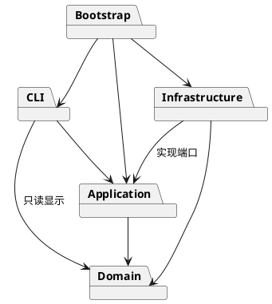

# Lab1 Phase 1 架构与过程记录

## 架构方案

### 模块划分

| 模块 | 职责 |
|---|---|
| domain | 封装图形、几何、树结构与唯一 id 不变量 |
| application | Command 执行、历史管理、文档会话、持久化接口 |
| infrastructure | XML 与本地文件适配 |
| cli | 命令行分词、命令分发、REPL、显示 |
| bootstrap | 依赖组装与启动 |

### 设计模式

必须采用 Command：每种编辑一个命令类，通过统一历史管理器执行和撤销。采用 Composite：Group 和叶子同属 Shape，多态操作几何。采用集中式 ShapeFactory：所有类型名称到构造器的分派只在此处；命令名称到处理器的分派只在 CommandDispatcher。

两处名称分派均为后续待重构项：未来以插件注册机制替代内置清单。本阶段不实现 box 或完整插件系统。

### 依赖方向规则

Domain 不依赖其他层、Node IO 或 XML 库。Application 只依赖 Domain；持久化端口定义于 Application。Infrastructure 实现端口，可以依赖 Domain。CLI 依赖 Application，并允许只读访问 Domain 进行显示。Bootstrap 负责组装。测试可跨层验证。

### 变化点假设

1. 图形类型扩展：保留 Shape 多态和集中工厂；暂不实现动态插件加载。
2. 交互通道扩展：Command 和领域行为不依赖 REPL，可用于未来 GUI/agent。
3. 存储格式变化：通过 DocumentStore 端口隔离 XML 和磁盘。
4. 大文档历史性能：本阶段采用封装快照保证结构撤销可靠；规模扩大时替换为增量备忘录。

### 歧义决策

- 跨父节点 group：最低公共祖先作为新组父节点，原文档先序遍历决定成员顺序，最早被选中分支决定插入位置。
- 重复 id 拒绝导入；缺 id 先扫描显式 id，再分配不冲突编号。
- 文档命令成功后清空历史并设置屏障；失败不改变历史。canvas 查询不设置屏障。
- front 对应 SVG 后绘制（同级列表末尾），back 对应先绘制（开头）。
- 暂不支持复杂 SVG 元素或 transform；涉及渲染语义的未支持内容明确报错，避免静默损失。

## 过程记录

### 方案核验与工程建立

用户先要求方案，确认后指示开始实现。目标目录原为空，已初始化独立 Git 仓库。使用 AI 实现者和 AI 复核者两种视角；此处不将 AI 自查冒充人工校验，也不编造讨论。

环境检查发现 Node 与 pnpm 可用，npm 不在 PATH，使用随附 pnpm 管理本项目依赖，不修改全局环境。

### 复核 A：领域模型

六种类型共享 Shape/GeometryShape，几何和样式封装在私有字段。树查询采用遍历，避免同时维护父指针、id 缓存和子列表造成多份状态失配；本阶段小文档接受 O(n) 查询，唯一 id 在添加整棵子树前验证。相较方案中的 id 索引，这是主动简化，后续有性能依据再引入索引。

首次类型检查发现 TypeScript 7 不再隐式加载 Node 类型，已在 tsconfig 中显式声明 types: [node]。领域测试覆盖递归移动缩放、唯一 id、缺失容器、未知类型、非法尺寸、属性白名单和快照隔离。

### 基础编辑

EditorOperations 提供与 CLI 无关的编辑入口。验证了 in 指定父容器、缺省样式不写属性、浮点坐标、文本修改、删除子树，以及失败创建不会插入孤立节点。

### 复核 B：命令原子性与历史

复核发现：只在叶子层先验证不足以保证整组操作原子性。组内前面的图形缩放成功、后面的巨大坐标溢出时，会发生部分修改。SnapshotCommand 在修改前保留封装的深克隆，异常时恢复；HistoryManager 仅在 execute 成功后更新栈。用两个子图形（普通坐标与 1e308）的溢出回归测试确认整组回滚，且失败命令不占撤销单元。

另验证了失败编辑保留 redo，成功新编辑清空 redo，以及 IO 屏障必须等下一次成功编辑才解除。历史在本阶段使用全文档快照，时间和存储为 O(文档大小 × 历史长度)，是明确的规模取舍。

### 复核 C：层级及绘制顺序

group 先验证所有成员和祖孙冲突，再统一摘出。跨父节点测试故意以逆序参数输入，确认结果仍按原树顺序；撤销一次完整恢复原父节点和兄弟次序。ungroup 只允许非根级组，子节点替换原组槽位。front 放到 SVG 子列表末尾（后绘制），back 放到开头，避免把“最前”误解为数组开头。循环 addto、组与其后代同时选中均有失败回归测试。

### CLI 解析复核

Tokenizer 保留参数是否被双引号包裹的信息，避免将文字内容 "in" 误识别成父容器子句。注释仅在整行第一个非空白字符为 # 时生效，颜色 #4a90d9 不会被截断。Windows 路径中的普通反斜杠保持原样，仅引号内的双引号和反斜杠支持转义。help 可在尚未建文档时使用，其余依赖文档的命令拒绝执行。首轮 CLI 测试发现断言把属性分隔空格数量固定为一个，已改成验证语义允许连续空白。

## 一致性自查

待最终代码完成后以实际目录、导入关系与检查结果填写。

## 质量保证手段

计划执行领域不变量、命令原子性、撤销历史、SVG 往返和作业会话集成测试；最终记录实际结果。
